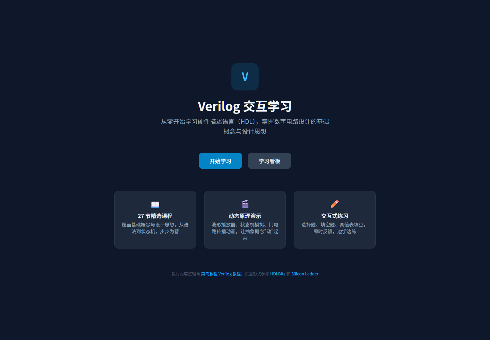
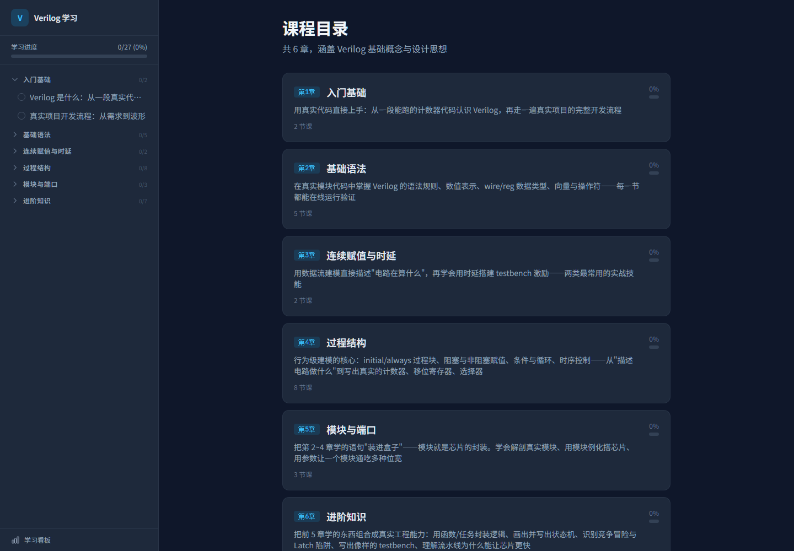
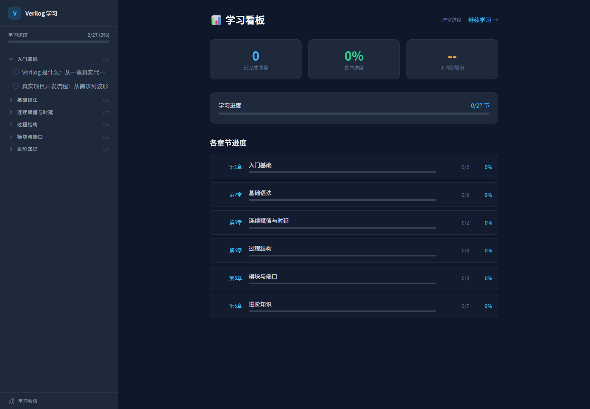
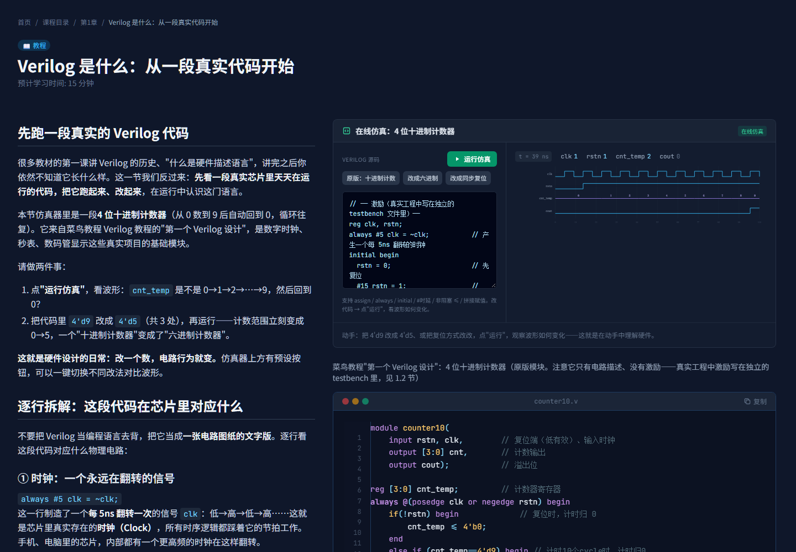

# Verilog 交互学习 · Verilog Interactive Learning

> 6 章 27 节，从语法到状态机；边读边跑仿真，把抽象概念“动”起来。
> React + TypeScript + Vite，纯静态部署，进度保存在浏览器本地。

[](LICENSE)
[](https://react.dev/)
[](https://vite.dev/)
[](https://www.typescriptlang.org/)



## 功能特性

- **6 章 27 节系统课程**：入门、基础语法、连续赋值与时延、过程结构、模块与端口、进阶知识。
- **内置微型 Verilog 仿真器**：支持 `reg/wire`、向量、`assign`、`initial`、`always #N` 时钟、
  `always @(posedge/negedge)` 时序块、`always @(*)` 组合块、`if/else`、拼接与非阻塞赋值，实时出波形。
- **可视化原理演示**：波形播放器、状态机（自动售卖机）、门电路信号传播、3 级流水线，支持播放/暂停/步进。
- **交互练习**：单选/多选、填空题、真值表填空，即时判分与解析。
- **学习进度**：自动保存到 `localStorage`；学习看板展示各章进度、平均分、最近完成，可一键清空。
- **SPA 体验**：HashRouter + 相对路径，GitHub Pages 子路径、刷新、直达链接都不 404。
- **响应式**：桌面侧栏，移动端顶部导航；课程页双栏在窄屏自动堆叠。
- **可选看板娘**：Live2D 挂件随仓库分发，模型不随仓库分发；没有模型时自动跳过，不影响学习功能。

## 截图

| 课程目录 | 学习看板 |
| --- | --- |
|  |  |

课程页：左侧读文字，右侧常驻仿真/代码（桌面端 sticky）：



## 快速开始

需要 Node.js 18+（推荐 20+）。

```bash
npm install
npm run dev        # 开发服务器，默认 http://localhost:5173
npm run build      # 类型检查 + 生产构建到 dist/
npm run preview    # 预览生产构建
```

Windows 用户也可以双击 `start.bat`：脚本会自动检查 Node、按需安装依赖、构建并启动预览服务器。

## 部署到 GitHub Pages

1. 推送到 GitHub 的 `main` 分支。
2. 仓库 **Settings → Pages → Source** 选择 **GitHub Actions**。
3. `.github/workflows/pages.yml` 会自动构建并发布 `dist/`。

项目使用 `base: './'` + `HashRouter`，所以部署在 `https://<user>.github.io/<repo>/` 这类子路径下也能正常工作，
不需要额外的 404 回退配置。

## 项目结构

```text
.
├── index.html
├── src/
│   ├── main.tsx                # HashRouter + 进度 Provider
│   ├── App.tsx                 # 路由表
│   ├── pages/                  # 首页 / 课程 / 看板 / 404
│   ├── components/
│   │   ├── Layout.tsx          # 侧栏、移动端导航、滚动复位
│   │   ├── LessonView.tsx      # 课程正文 + 右侧仿真/代码
│   │   ├── Quiz.tsx            # 选择题
│   │   ├── FillBlank.tsx       # 填空题
│   │   ├── TruthTable.tsx      # 真值表
│   │   ├── Live2DWidget.tsx    # 可选看板娘（自动探测模型）
│   │   └── visuals/            # 波形 / FSM / 门电路 / 流水线 / 仿真器
│   │       └── sim/            # 迷你 Verilog 解析器 + 离散事件仿真
│   ├── data/courses.ts         # 6 章 27 节课程数据
│   └── context/ProgressContext.tsx
├── public/
│   ├── favicon.svg
│   └── live2d-widget/          # 看板娘挂件（GPL-3.0）
├── tests/                      # Vitest 单元测试
├── docs/                       # 截图与历史规划
└── .github/workflows/          # CI + GitHub Pages
```

## 课程数据

课程集中放在 `src/data/courses.ts` 的 `chapters` 数组中，一节长这样：

```ts
{
  id: 'ch01-l01',
  title: 'Verilog 是什么：从一段真实代码开始',
  type: 'article',
  estimatedMinutes: 15,
  content: `<p>HTML 正文…</p>`,
  codeExamples: [{ filename: 'counter10.v', code: 'module …' }],
  quiz: { questions: [{ id, type: 'single', stem, options, answer, explanation }] },
  visuals: [{ type: 'sim', props: { title, initialCode, duration, signals } }],
}
```

新增课程只需要在对应章节追加对象；`tests/courses.test.ts` 会检查 id 唯一、答案在选项内、
真值表行数匹配、可视化类型合法等，避免内容“写崩了没发现”。

## 测试与质量

```bash
npm test           # Vitest：课程数据完整性 + 仿真引擎（12 个用例）
npm run typecheck  # tsc 严格模式
npm run build      # 生产构建
```

CI（`.github/workflows/ci.yml`）在每次 push / PR 时执行 `npm ci`、类型检查、测试和构建。

## Live2D 看板娘（可选）

`public/live2d-widget/` 是 [live2d-widget](https://github.com/stevenjoezhang/live2d-widget)（GPL-3.0）的本地化副本，
挂件本身随仓库分发；**Live2D 模型不随仓库分发**（体积大、角色版权独立）。

启用方式：

1. 准备一个模型目录，根目录包含 `model_list.json`（结构与 live2d-widget-models 一致）。
2. 放到 `public/live2d-models/`，让路径形如 `public/live2d-models/model_list.json`。
3. `npm run dev` 或重新构建；页面加载时会自动探测并初始化看板娘。

关闭方式：在 `.env.local` 中设置 `VITE_DISABLE_LIVE2D=1`。

授权细节见 [THIRD_PARTY_NOTICES.md](THIRD_PARTY_NOTICES.md)。模型通常来自游戏角色，
公开部署前请确认你拥有相应使用/分发权利。

## 内容来源与授权

- 课程知识点参考、整理自 [菜鸟教程 Verilog 教程](https://www.runoob.com/w3cnote/verilog-tutorial.html)；
  交互形式参考 [HDLBits](https://hdlbits.01xz.net/) 与 [Silicon Ladder](https://siliconladder.com/)。
- 上述课程内容的版权归原作者，本项目中的整理版本仅用于个人学习与教学演示。
- **代码**（含看板娘挂件）按 **GPL-3.0** 发布，见 [LICENSE](LICENSE)。第三方组件说明见
  [THIRD_PARTY_NOTICES.md](THIRD_PARTY_NOTICES.md)。

## 已知限制

- 仿真器是面向教学的子集，不支持模块例化、`generate`、四值逻辑、多驱动等完整 Verilog 语义。
- 看板娘依赖 Live2D Cubism 2 运行时，模型缺失时会静默跳过。
- 字体通过 Google Fonts 加载，离线环境会回退到系统字体。
